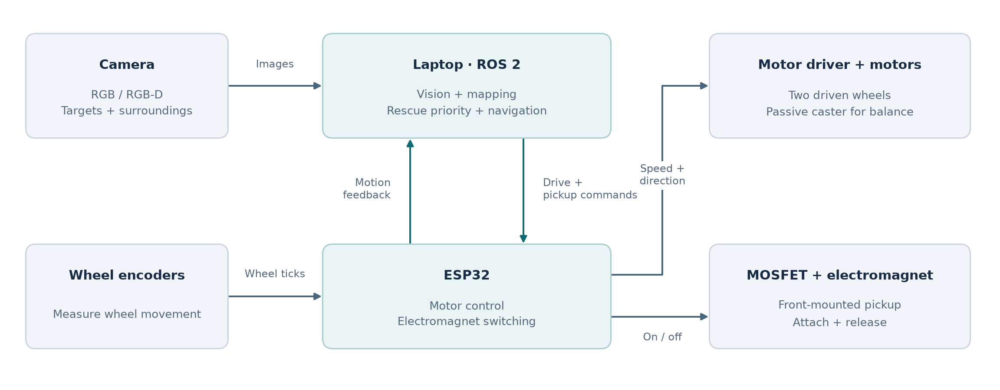

# FireResQ — Intelligent Search-and-Rescue Robot

## Description

FireResQ is a low-cost mobile robot designed to search a controlled indoor rescue arena, identify lightweight victim models, and transport them to a safe zone. Its central capability is deciding which victim needs attention first. It considers proximity to a visible fire marker, the available route, the effort needed to reach the victim, and the return journey. This connects what the robot sees with what it physically does: observe the scene, choose a target, drive to it, retrieve it, and return it to safety.

The robot combines a compact two-wheel chassis, a camera, wheel encoders, an ESP32 controller, and a front electromagnet. A laptop handles image processing, mapping, navigation, and rescue decisions. The ESP32 turns those decisions into motor movement and magnet switching. Together, these components form a robot that can choose and carry out a rescue sequence using information gathered from its surroundings.

### Seeing and locating targets

A front-facing camera provides the robot's view of the arena. Image processing identifies the victim models and the visual fire marker, while mapping uses environmental features or depth measurements to describe the surrounding space. Each detected target is associated with an estimated position, allowing the robot to work out where to go and how the target relates to the fire and safe zone.

The design supports RGB and RGB-D cameras. An RGB camera provides colour images, with calibrated geometry and known object dimensions supporting target-distance estimates. An RGB-D camera adds depth measurements for more direct distance estimation and obstacle mapping. The mapping and localization method follows the selected camera, while the rescue decision layer receives the same information about targets and their positions.

### Building a useful picture of the arena

FireResQ uses mapping and localization to connect camera observations with the robot's position. Wheel encoders measure how much each driven wheel turns, providing an estimate of distance travelled and changes in heading. Mapping and localization use the available camera information alongside this motion estimate to place the robot within the arena.

The robot also keeps a record of detected victims, the fire marker, the safe zone, and rescue progress. Each victim has a location, a confidence estimate, and a status such as detected, selected, carried, or rescued. This memory lets the robot retain a target after it leaves the camera's view and exclude victims already delivered to the safe zone.

### Choosing which victim to rescue

The decision layer compares the remaining victims using several practical questions: How close is the victim to the fire marker? Can the robot reach it? How long is the route? How much travel is needed to bring it back? How confident is the robot about the detection?

These factors contribute to a weighted priority score. Fire proximity increases urgency, while longer journeys increase rescue cost. Route accessibility and detection confidence help the robot choose a target it can reasonably retrieve. The travel estimate includes both the outward trip and the return to the safe zone, so a short approach does not automatically mean an easy rescue.

For example, the robot may choose a more distant victim close to the fire marker before a nearby victim farther from danger, provided a usable route exists. It recalculates priorities after each rescue using its updated position and observations. The decision can also report the contributing factors, making the selected order understandable to an operator.

### Moving to the selected victim

Once a target is selected, the navigation system plans a route through the mapped free space. ROS 2 connects the sensing, decision, navigation, and control components, while Nav2 provides path planning and motion commands. The route accounts for obstacles and the robot's physical footprint so the chassis can approach the target with room to manoeuvre.

Two independently driven DC geared motors move the robot. Changing their relative speeds makes it travel straight, follow a curve, or turn on the spot. A passive caster supports the chassis. The ESP32 receives movement commands, controls the motor driver, and returns encoder measurements so the laptop can track progress towards the target.

### Retrieving and delivering the victim

The rescue mechanism is a low-voltage electromagnet mounted at the front of the chassis. Each lightweight victim model carries a steel ring, washer, or attachment plate positioned to meet the magnet. The robot approaches the selected model, aligns its front with the attachment point, and moves slowly into pickup position.

The ESP32 then switches the electromagnet through a MOSFET driver. The energized magnet holds the model while the robot follows a return route to the safe zone. At the delivery position, the controller switches the magnet off to release the model. The mission controller updates the rescue record and starts the next selection cycle. The mounting height, holding force, and model mass are matched to make this pickup-and-transport mechanism practical.

### Coordinating the physical hardware

The laptop and ESP32 have distinct responsibilities. The laptop processes images, maintains the map and victim records, compares rescue options, and plans movement. The ESP32 handles the immediate electrical tasks: reading encoders, controlling motor speed and direction, and switching the electromagnet. Their communication carries movement commands, motion feedback, and actuator commands between these two levels.

A battery supplies the motors and electromagnet, while a regulated supply powers the control electronics. The magnet driver includes protection against the coil's switching transients. The physical controller is designed to stop the motors if movement commands cease, preventing the robot from continuing on an outdated command. Camera calibration, wheel dimensions, and magnet placement connect the software's position estimates to the physical chassis.

### Continuing the rescue mission

After each delivery, FireResQ observes the scene again and updates what remains to be done. It can select another known victim or move to another viewpoint to search areas that have not been adequately observed. An unsuccessful approach is recorded so that the decision layer can reconsider the target and remaining options. This repeated cycle links sensing, judgment, movement, and retrieval throughout the mission, with every new rescue selected from the current situation.

## Architecture

## References

- Esteves Henriques, B., Baglioni, M. & Jamshidnejad, A. (2024). “Camera-based mapping in search-and-rescue via flying and ground robot teams.” *Machine Vision and Applications*, 35, 117. Springer.
- de Koning, C. & Jamshidnejad, A. (2023). “Hierarchical Integration of Model Predictive and Fuzzy Logic Control for Combined Coverage and Target-Oriented Search-and-Rescue via Robots with Imperfect Sensors.” *Journal of Intelligent & Robotic Systems*, 107, 40. Springer.
- Macenski, S., Singh, S., Martín, F. & Ginés, J. (2023). “Regulated pure pursuit for robot path tracking.” *Autonomous Robots*, 47, 685–694. Springer.
- Mokssit, S., Bonilla Licea, D., Guermah, B. & Ghogho, M. (2023). “Deep Learning Techniques for Visual SLAM: A Survey.” *IEEE Access*, 11, 20026–20050. IEEE.
- Portugal, D., Rocha, R. P. & Castilho, J. P. (2025). “Inquiring the robot operating system community on the state of adoption of the ROS 2 robotics middleware.” *International Journal of Intelligent Robotics and Applications*, 9, 454–479. Springer.
- Baglioni, M. & Jamshidnejad, A. (2024). “A Novel MPC Formulation for Dynamic Target Tracking with Increased Area Coverage for Search-and-Rescue Robots.” *Journal of Intelligent & Robotic Systems*, 110, 140. Springer.
- Wei, C., Li, Y., Ouyang, Y. & Ji, Z. (2023). “Deep Reinforcement Learning with Heuristic Corrections for UGV Navigation.” *Journal of Intelligent & Robotic Systems*, 109, 18. Springer.
- Talaat, F. M. & ZainEldin, H. (2023). “An improved fire detection approach based on YOLO-v8 for smart cities.” *Neural Computing and Applications*, 35, 20939–20954. Springer.
- Chen, Y., Li, Y., Zheng, W. & Wan, X. (2024). “Transformer fusion-based scale-aware attention network for multispectral victim detection.” *Complex & Intelligent Systems*, 10, 6619–6632. Springer.
- Ding, W., Yang, T., Li, J., Hua, C. & Mu, D. (2025). “A Real-Time Flame Detection and Situation Assessment Algorithm for Firefighting Robots.” *Fire Technology*, 61, 2571–2591. Springer.
